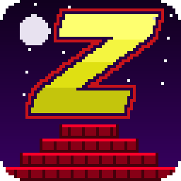

<h1 align="center">ZiGGURAT Recomp</h1>

An unofficial native PC port of <b>ZiGGURAT</b> (iOS, 2012), with a launcher.

> **This project does not include any game files.**
> You need your own legally obtained copy of ZiGGURAT for iOS. The launcher reads the art, music and
> text from it on your computer. Nothing from the game is stored in this repository or in its releases.

ZiGGURAT Recomp is an unofficial, non-commercial fan project for preservation. It is **not affiliated
with or endorsed by Action Button Entertainment** or any other rights holder. ZiGGURAT and all of its
content belong to their respective owners.

We do not condone piracy. Issues or discussions asking for game files will be closed.

> **Photosensitivity warning:** the game contains flashing lights and screen flashes. The launcher has a
> **Reduce flashing** option (GAME → ACCESSIBILITY) that dims them.

## Features
* Native C++/SDL3 reconstruction of the original game logic, running at the original 30 fps (or 60 fps,
  as on retina iPhones). The original quirks are kept by default.
* **Launcher** styled after the game:
  * first-run wizard that imports your dump
  * display: windowed / borderless / exclusive, integer scaling, filters, border art
  * audio, language
  * controllers
  * Steam integration
  * records, backups
  * accessibility and enhancements
* **Controller support**: a "virtual finger" drives the original touch controls, for both precision and
  slingshot mode. Remapping, deadzones, gyro aiming, optional rumble.
* **Add to Steam** in one click, with library artwork generated on your PC from your own dump.
* **Records**: full stats view, export/import, automatic backups, import from an old iPhone backup.
* 7 languages (English, Deutsch, Español, Français, Italiano, Português, Português do Brasil).
* Portable mode.

## Quick start (Windows)
1. Download the latest `ZigguratRecomp-<version>-windows-x64.zip` from the
   [Releases page](../../releases) and extract it anywhere.
2. Run `ZigguratLauncher.exe`.
3. When asked, select your ZiGGURAT dump. The launcher checks it, imports it in a few seconds and shows the game theme.
4. Press **PLAY NOW**.

Linux builds are configured in CI (see `docs/BUILD_LINUX.md`; not yet play-tested). macOS is not supported yet.

### Accepted dumps
* An `.ipa` file of ZiGGURAT for iOS.
* The `Zig2.app` folder.
* Any folder that contains one of the above.

Encrypted App Store copies work too: the port only uses the art, audio, font and text, which are not
encrypted. Compressed wrappers (`.zip`, `.rar`, `.7z` around the `.ipa`) must be extracted first.

The dump is verified against a manifest of 188 files (SHA-256). Version 1.0.1 (`0001.00.01`) is fully
verified. Other versions can be imported as "unverified" if all files are present.

## Controls
The original is a touch game. The mouse works like your finger: press = touch, drag = slide, release = lift.

| Action | Controller (default) | Keyboard |
|---|---|---|
| Touch / charge (hold) | RT or A | Space |
| Aim (precision: slide) | left stick / d-pad | A / D |
| Pull (slingshot) | left or right stick | W / S / A / D |
| Recenter aim | right-stick click | R |
| Gyro aim while held (optional) | LB | - |
| Menus | stick moves the cursor, A taps | mouse |

Everything can be remapped in the launcher (CONTROLS). See `docs/CONTROLLERS.md`.

## Steam
STEAM tab in the launcher → **ADD TO STEAM**:
* Adds a non-Steam shortcut with generated artwork (capsule, wide, hero, logo, icon).
* Steam must be closed; the launcher can close it for you.
* Every change is backed up first, and **UNDO** restores the previous state.

Details are in `docs/STEAM.md`.

## Where your data lives
| | Windows | Linux |
|---|---|---|
| settings, records, logs, imported files | `%APPDATA%\ZigguratRecomp\` | `~/.local/share/ZigguratRecomp/` |
| portable mode (empty `portable.txt` next to the launcher) | `<launcher folder>\data\` | same |

See `docs/DATA.md`.

## Privacy
No telemetry and no network access, except the **optional** update check (off by default, and no
release feed is configured in official builds).

## FAQ
**Windows says "Windows protected your PC" (SmartScreen).**
The executables are not code-signed. Choose *More info → Run anyway*, or build from source.

**My antivirus flags the launcher.**
The launcher can edit Steam's shortcut file and close Steam (only when you click those buttons), which some
heuristics dislike. Only download builds from this repository's **Releases** page, and compare the
SHA-256 checksums published with each release.

**Where can I get the game?**
Not here. Use your own copy.

**Does my old progress carry over?**
The launcher can import records from an unencrypted iPhone/iTunes backup (DATA → SAVES & BACKUPS).

## Building from source
* Windows: `docs/BUILD_WINDOWS.md` (MSYS2/MinGW + CMake + Ninja).
* Linux: `docs/BUILD_LINUX.md`.
* Architecture overview: `docs/ARCHITECTURE.md`.

## Credits
**ZiGGURAT** (2012) by Action Button Entertainment:
* Game design / director: Tim Rogers
* Program: Michael Kerwin
* Graphics: Brent Porter
* Sound: Andrew Toups
* Special thanks: Bennett Foddy, Tracey Lien, Zak McCune

Engine: **flixel-ios** by Semi Secret Software (MIT), translated to C++.

Third-party libraries: see `THIRD_PARTY_LICENSES.md`.

## Licence
* The original code of this project is under the MIT licence (`LICENSE`).
* The engine is MIT, © Semi Secret Software (`port/src/engine/ENGINE_LICENSE.txt`).
* The game-logic reconstruction is covered by `port/src/game/README.md`; the project licence grants no rights to the original game.
